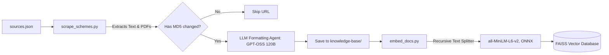

# 🤖 Data Ingestion, Processing, & Testing Agents Guide

This guide details the background agents and scripts responsible for populating the database, indexing files for search, creating fine-tuning datasets, and executing automated pipeline tests. The primary files discussed are:
1. **Scraping Agent**: [scrape_schemes.py](../scripts/scrape_schemes.py)
2. **Indexing & Update Agents**: [embed_docs.py](../scripts/embed_docs.py) & [update_all.py](../scripts/update_all.py)
3. **Dataset Generator Agent**: [prepare_finetune_data.py](../scripts/prepare_finetune_data.py)
4. **Verification Testing Agent**: [test_logic.py](../scripts/test_logic.py)

---

## 🏗️ Ingestion & Indexing Pipeline

The background ingestion system downloads official government pages, structures them, and indexes them into the vector database.



---

## 🕷️ Ingestion & Formatting Agent: `scrape_schemes.py`

This agent handles web scraping and structures unstructured government documents into clean Markdown.

### 1. Ingestion Phase
* The agent reads target portals from [sources.json](../knowledge-base/sources.json).
* It downloads page contents using `requests` or processes PDF links using `pypdf.PdfReader` to extract raw text page-by-page.
* It calculates the MD5 hash of the raw text and checks it against [seen_hashes.json](../scripts/seen_hashes.json). If the hash matches, it skips the URL to save API tokens.

### 2. LLM Structuring Phase
* If changes are detected, the agent sends the raw text to `openai/gpt-oss-120b` on Groq (override with `GROQ_SCRAPE_MODEL`).
* Long pages are processed in **10,000-character parts** (up to 8 per source). The old single 4,000-character cut saw under 10% of a scheme guideline PDF, so amounts and eligibility rules deeper in the document never reached the knowledge base.
* The prompt carries **accuracy rules**: use only facts in the text, copy amounts and eligibility rules exactly, and write "Not stated in the source." rather than filling a gap.
* `python scripts/scrape_schemes.py --new-only` scrapes only sources that have never been scraped (for example, right after adding some to `sources.json`).
* The LLM acts as an agent to extract scheme details and format them into structured Markdown containing:
  - **YAML Frontmatter Parameters**: `scheme_name`, `ministry`, `category`, `disability_types`, `last_updated`, and `source_url`.
  - **Standard Headers**: `## Overview`, `## Benefits`, `## Eligibility criteria`, `## Required documents`, `## How to apply`, and `## Contact`.
  - **Multi-Scheme Splitting**: If multiple schemes are found, the LLM splits them using `---NEXT SCHEME---`.

### 3. File System Storage
* The scheme name is converted into an alphanumeric URL-friendly slug.
* Files are saved to `knowledge-base/<category>/<slug>-<date>.md`. If a filename collision occurs, it appends a counter (`_1`, `_2`) to prevent overwriting existing data.
* The script updates `seen_hashes.json` with the new MD5 hash **only after the LLM step succeeds**. Recording it first meant a page whose LLM call failed was skipped forever as "No changes detected".

---

## 🏫 Directory Agent: `fetch_directory.py`

The knowledge base describes **schemes**; it cannot name a school. This script builds `knowledge-base/directory/centres.json` from official lists of actual organisations:

* **National Trust Registered Organisations** (~450, all states, by district): name, address, contact, and which National Trust schemes each runs (Disha early intervention, Vikaas day care, Samarth respite care, Gharaunda group homes, Niramaya enrolment). They serve autism, cerebral palsy, intellectual disability and multiple disabilities.
* **DEPwD National Institutes and Composite Regional Centres**: national and regional centres for every disability type, with websites. Their state names are normalised (DEPwD writes "A.P.", "Chattisgarh" or nothing).

The site pages its list 10 at a time and, past the end, keeps returning the last page rather than an empty one, so the script stops on a short page. It waits 1 second between pages. `chatbot/directory.py` looks entries up by the district or state named in the conversation. `update_all.py` refreshes the file after scraping and embedding; a failure there is not fatal.

---

## 📂 Indexing & Update Agents: `embed_docs.py` & `update_all.py`

Once documents are stored, they must be converted into vector embeddings for semantic search.

### 1. Chunking & Indexing (`embed_docs.py`)
* **Loading**: Recursively loads all `.md` files under `knowledge-base/` using LangChain's `DirectoryLoader` and `TextLoader`.
* **Splitting**: Segments documents into 500-character blocks with 50-character overlap using `RecursiveCharacterTextSplitter`. Splitting prioritizes Markdown markers (`\n##`, `\n###`, `\n-`) to preserve table lists and bullet points.
* **Scheme labels**: Prefixes every chunk with the scheme it belongs to (e.g. `[Scheme: NIRAMAYA Health Insurance Scheme | For: autism, …]`) and stores `scheme_name` in its metadata, so a chunk that never names its scheme can still be matched to it.
* **Vector Generation**: Generates 384-dimensional vector embeddings with `all-MiniLM-L6-v2`, run as ONNX through fastembed (`chatbot/embeddings.py`, the same model the server searches with; no PyTorch).
* **Save**: Writes the compiled index to [scripts/vector_store/](../scripts/vector_store/) (saving `index.faiss` and `index.pkl`).

### 2. Update Coordinator (`update_all.py`)
* Orchestrates the update pipeline by running `scrape_schemes.py` first, followed by `embed_docs.py` as separate subprocesses.
* Can be run via the Windows batch script [run_updates.bat](../run_updates.bat) located in the project root.

> **Note**: `embed_docs.py` writes the index that the live app loads from `scripts/vector_store/`. Restart the server after re-embedding so the new index is picked up.

---

## 🎯 Fine-Tuning Dataset Generator: `prepare_finetune_data.py`

This script parses the Markdown database to generate instruction-tuning data. This is useful for training custom models (e.g., using Unsloth or HuggingFace TRL).
* It reads all files under `knowledge-base/` and generates three instruction-tuning pairs for each scheme:
  1. **General Info**: `Provide a detailed overview of the <Scheme Name>.` $\rightarrow$ Outputs the full Markdown content.
  2. **Benefits**: `What are the benefits provided under the <Scheme Name>?` $\rightarrow$ Outputs the parsed `## Benefits` section.
  3. **Eligibility**: `Who is eligible for the <Scheme Name> in India?` $\rightarrow$ Outputs the parsed `## Eligibility criteria` section.
* **Output**: Saves the dataset as an Alpaca-style JSONL file at [finetune_dataset.jsonl](../scripts/finetune_dataset.jsonl).

---

## 🔄 Automation: GitHub Actions

Two workflows keep the knowledge base current without manual intervention.

### `auto_scrape.yml` — Monthly scrape and update
Runs on a cron schedule (`0 0 1 * *`) and on manual dispatch:
1. Installs dependencies.
2. Runs `scrape_schemes.py` with `GROQ_API_KEY` from repository secrets.
3. Runs `embed_docs.py` to rebuild the index.
4. Commits `knowledge-base/`, `scripts/seen_hashes.json` and `scripts/vector_store/` back to `main` via `git-auto-commit-action`.

### `embed_on_push.yml` — Re-embed on push
Triggers whenever `knowledge-base/**` changes on `main`, rebuilding and committing the vector store.

### ⚠️ Critical `.gitignore` constraint
Both workflows **commit** `scripts/vector_store/` and `scripts/seen_hashes.json`. Those paths must therefore **never be listed in `.gitignore`**. When they were ignored, `git add` on an ignored path exited with status `1`, and every scheduled run failed at the final step with:

```
The following paths are ignored by one of your .gitignore files:
scripts/seen_hashes.json
scripts/vector_store
Error: Invalid status code: 1
```

The scrape and embed steps had already succeeded — only the commit failed. Keep those two paths un-ignored.

### Expected partial failures
Several `.gov.in` portals silently drop connections from GitHub's datacenter IP ranges, producing `ConnectTimeout` or `Connection refused` for a handful of sources on every run. This is **normal and non-fatal**: `scrape_schemes.py` catches errors per source and continues, so a run still succeeds with the sources that do respond.

---

## 🧪 Verification & Testing Agent: `test_logic.py`

To prevent regression errors in the RAG pipeline, this script runs automated test assertions on the system response.
* **Query**: Test query asks about a child who cannot study due to a mental disability.
* **Assertions**:
  - Verifies that the RAG model does not suggest educational scholarships or student-only benefits.
  - Checks if the response contains the keywords `"scholarship"` or `"student"`. If they are present, it verifies that the model explicitly acknowledged the constraint with the phrase `"since your child cannot pursue education"`.
  - If the model recommends student benefits without acknowledging the constraint, the test prints a failure log to alert developers.
