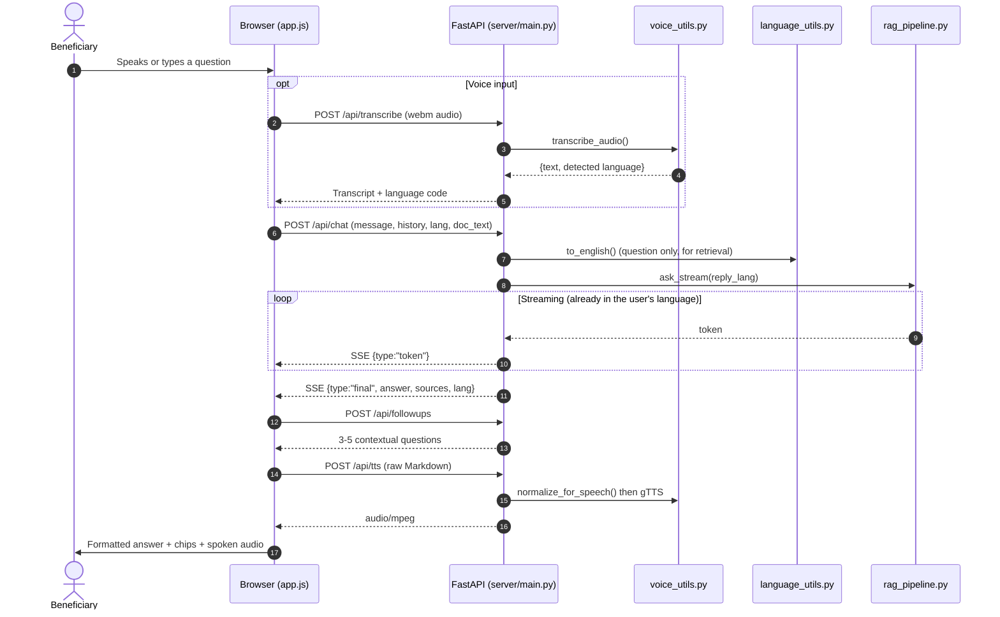

# 🖥️ Frontend, API & Voice Guide

This guide covers the web layer: the FastAPI backend, the vanilla-JS client, voice input/output, follow-up suggestions, accessibility, and translation. Files discussed:

1. **API server**: `server/main.py`
2. **Client**: `frontend/index.html`, `frontend/style.css`, `frontend/app.js`
3. **Voice utilities**: `chatbot/voice_utils.py`
4. **Translation engine**: `chatbot/language_utils.py`
5. **Legacy Streamlit UI**: `chatbot/app.py`

---

## 🔁 User Request Lifecycle



---

## 🌐 API Reference (`server/main.py`)

| Endpoint | Method | Purpose |
|---|---|---|
| `/api/health` | GET | Liveness probe; returns the supported-language map used to populate the UI dropdown. |
| `/api/chat` | POST | Streams the answer as Server-Sent Events. |
| `/api/followups` | POST | Returns 3–5 contextual follow-up questions for the latest turn. |
| `/api/insights` | POST | Returns the user's stated profile and matched schemes (eligible / check / not eligible) for the side panel. |
| `/api/transcribe` | POST | Multipart audio → `{text, lang}` via Whisper. |
| `/api/tts` | POST | `{text, lang}` → `audio/mpeg`. Returns **204** when the language has no voice. |
| `/api/upload` | POST | PDF/TXT/MD → extracted plain text for document Q&A. |
| `/` | GET | Serves the static single-page frontend. |

### Streaming contract (`/api/chat`)

The answer is generated **directly in the user's language** and streamed token-by-token, then a single `final` event carries the link-checked answer and metadata:

```jsonc
{"type": "token", "text": "..."}          // repeated
{"type": "final",
 "answer": "...",             // in the user's language
 "english_question": "...",   // English question (used for routing, retrieval and the matches panel)
 "sources": ["scheme.md"],
 "source_links": [{"name": "State Disability Pension", "url": "https://..."}],  // from KB front matter
 "lang": "hi",
 "tts_available": true}
{"type": "error", "code": "rate_limit", "message": "..."}  // plain-language message; detail in the server log
```

Static files are mounted **last** so `/api/*` routes take precedence over the catch-all mount.

---

## 📱 The Client (`frontend/app.js`)

Plain ES2020 — no framework, no bundler, no build step.

### Layout

One responsive page, no separate mobile app:

| Width | Layout |
|---|---|
| ≥ 1280px | Chat history · conversation · **Your matches** panel (profile + matched schemes + sources) |
| 1024–1279px | Conversation · matches panel; chat history moves into a drawer |
| < 1024px | Conversation only; matches open as a drawer (tablet) or bottom sheet (phone) |

The home screen says who the app is for before anything else: under "Namaste" it reads *"Government help for persons with disabilities and their families"*, followed by a one-line list of what it covers (shown on phones too). The top-bar tagline, the browser-tab title and the link preview shown when the address is shared (WhatsApp, Facebook: `og:` tags in `index.html`) say the same. Phones get a voice-first home screen (topic tiles, language chips, a large mic button). Base text is 18px on every screen size (not the usual 16px), for older readers. Icons are an SVG sprite (`frontend/icons.svg`, Tabler Icons, MIT).

### Matched schemes (`chatbot/insights.py`)

After each answer that used retrieval, the client calls `/api/insights`. One LLM call extracts the facts the user has *stated* (state, age, disability, %, income, occupation) and judges up to 4 retrieved schemes against their Benefits/Eligibility sections. Scheme names and links come from the knowledge-base front matter, never the model, so the panel cannot invent a scheme or URL. Unknown criteria produce **Check details** rather than a guess.

### Key capabilities

1. **Streaming rendering** — `readSSE()` parses the SSE body from `fetch`, re-rendering Markdown on each token. A three-dot typing indicator shows before the first token arrives.
2. **Conversation management** — multiple conversations persist in `localStorage`, auto-titled from the first message. Audio blobs are stripped before persisting (they are not serialisable).
3. **Follow-up chips** — after each answer, `loadFollowups()` fetches contextual questions and renders them as clickable pills. Chips belong to the **latest turn only**: they are cleared when a new message is sent, so suggestions always reflect the current topic.
4. **Voice input** — the `MediaRecorder` API records WebM audio and posts it to `/api/transcribe`. The detected language is then forced as the reply language for that turn.
5. **Voice output** — the **raw Markdown** is posted to `/api/tts`; the server normalises it. Each answer has a **Listen / Stop** button (`aria-pressed`); with *Speak answers* on, the latest answer plays automatically.
6. **Document Q&A** — an uploaded file is extracted server-side and attached to subsequent questions as `doc_text`.
7. **Markdown + code** — rendered with `marked`, highlighted with `highlight.js` (CDN; can be vendored for offline use).

### Response formatting (`frontend/style.css`)

The LLM is instructed to emit structured Markdown, which the stylesheet renders as a polished document: `##` headings with underline rules, accent-coloured list markers and step numbers, bold key facts, accent-bordered blockquote callouts, styled tables, and source pills. Messages fade in; chips animate in with a stagger.

### Accessibility

- Skip link to the message box; `role="log"` + `aria-live="polite"` on the transcript.
- `aria-label` on every icon control; `aria-pressed` on the mic; `aria-current` on the active conversation.
- Visible `:focus-visible` outlines throughout; full keyboard operation (Enter sends, Shift+Enter newlines).
- `prefers-reduced-motion` disables all animation.
- One light theme ("Lotus & Indigo"; there is no dark mode), plus a **High contrast** toggle (pure black/white) and a three-step **Text size** control (18px, A+, A++), both remembered per browser.
- Drawers and the bottom sheet close with Escape and return focus to the control that opened them.

### Interface language (`frontend/i18n.js`, `frontend/i18n/`)

The whole interface (buttons, menus, messages, screen-reader labels, topic tiles, example questions) follows the chosen language, in all 13 languages, just as the answers do.

- **Where the text lives.** English and Hindi are inside `i18n.js`, so the first screen never waits. The other 11 are `frontend/i18n/<code>.json` (`ta`, `te`, `mr`, `bn`, `gu`, `kn`, `ml`, `pa`, `or`, `as`, `ur`), downloaded the first time that language is needed. A key missing from a file falls back to English, so a new English string never breaks the page. When you add a key to `STRINGS.en`, add it to `hi` and to each JSON file.
- **Which language.** A chosen language wins. On *Auto*, the interface follows the language the user last wrote or spoke in, else the phone's language, else English.
- **Urdu** sets `dir="rtl"`: the layout mirrors (chat history on the right, drawers slide in from the right, the send arrow flips). The stylesheet uses start/end properties (`margin-inline-start`, `border-inline-end`, `text-align: start`) instead of left/right so this works without separate rules. Urdu text uses Nastaliq where the device has it, with taller lines.
- **Profile labels** in the matches panel come from the server in English; the page shows its own translation by key (`profile_state`, `profile_age`, …).
- **Long words.** Tamil, Kannada and Malayalam words are long; the topic tiles let a word wrap rather than overflow, and the tile names were chosen to fit a 360 px phone without splitting a word.
- **Updates.** The JSON files are fetched with `cache: "no-cache"` (a small 304 when unchanged), so a corrected translation reaches users at once.

> The 11 JSON translations were written for this project in plain, everyday wording and have not yet been checked by native speakers. Corrections only need an edit to that language's JSON file.

---

## 🎙️ Voice Engine (`chatbot/voice_utils.py`)

### `transcribe_audio(audio_bytes, filename) -> (text, lang_code)`
Sends the clip to Groq **`whisper-large-v3`** with `response_format="verbose_json"`. Whisper detects the spoken language itself and handles code-switching — a decisive advantage over the browser Web Speech API, which requires the language to be fixed in advance. Whisper's language name (e.g. `"hindi"`) is mapped to an ISO-639-1 code. Returns `("", None)` on failure so the UI can prompt a retry.

### `normalize_for_speech(text) -> str`
Converts Markdown into text that **sounds** natural. Without it, TTS reads "asterisk asterisk" and "hash". It removes code fences, inline code, images, URLs, emoji, headings, bullets, numbering, bold/italic markers, blockquote arrows and table pipes — then terminates every line with a full stop so the engine **pauses between sections** instead of running everything together.

> Example: `## 💰 Financial benefits\n- **75% concession** on fare`
> becomes: `Financial benefits. 75% concession on fare.`

### `synthesize_speech(text, lang_code) -> bytes | None`
Normalises the text, then synthesises MP3 via gTTS. Returns `None` for languages gTTS cannot speak (**Odia** and **Assamese**) rather than mispronouncing them with an English voice — the UI then shows a "voice output isn't available" note. Upgrade path: swap in Azure/Google Cloud/ElevenLabs for premium voices and full coverage.

---

## 🌐 Translation Engine (`chatbot/language_utils.py`)

### Supported languages (13)
English (`en`), Hindi (`hi`), Tamil (`ta`), Telugu (`te`), Marathi (`mr`), Bengali (`bn`), Gujarati (`gu`), Kannada (`kn`), Malayalam (`ml`), Punjabi (`pa`), Odia (`or`), Assamese (`as`), Urdu (`ur`).

### Functions

### How answers reach the user's language

Answers, follow-up chips and the matches panel are **written by the LLM directly in the user's language** (`_language_instruction()` in `rag_pipeline.py`). The earlier design generated English and machine-translated it; the free Google endpoint rejects texts over ~5,000 characters and rate-limits bursts, and every failure silently fell back to English. That is why a long Hindi answer could arrive in English while the short follow-up chips were translated fine.

Machine translation now has two narrow jobs:
- **The question → English**, because the embeddings are English-only. `to_english()` tries Google first and falls back to the LLM if Google fails.
- **A safety net**: if the model still answers in English when another language was wanted, the answer is translated (`translate_to_language()`, which now splits long text into chunks and retries once).

**Hinglish** ("mujhe pension chahiye") detects as English, so `is_romanized()` spots text that changed substantially in translation, and the model is shown the user's original words and asked to reply in the same style.

### Functions

- **`translate_to_english(text) -> (translated, ok)`** — returns `ok=False` when the service failed, so callers can fall back.
- **`translate_to_language(text, lang_code) -> str`** — chunked, with one retry. Returns the input unchanged for `en`/`None`/errors.
- **`detect_language(text) -> str`** — `langdetect` with a fixed seed for deterministic results. Returns only supported codes, else `"en"`. Used for typed input when the language selector is on **Auto-detect**.
- **`get_language_code(name) -> str`** — display name → ISO code.

**Language resolution order:** an explicit sidebar override wins; otherwise the language Whisper detected from speech; otherwise `detect_language()` on typed text. The user therefore never has to choose a language.

---

## ⚠️ Legacy notes

- **Streamlit UI (removed)** — the original `chatbot/app.py` has been deleted. Streamlit's rerun-per-interaction model could not do true token streaming or full ARIA control, which is why the FastAPI + vanilla stack replaced it.
- **`scripts/translate.py`** — legacy translation helper covering only 11 languages. Use `chatbot/language_utils.py` for all new work.
